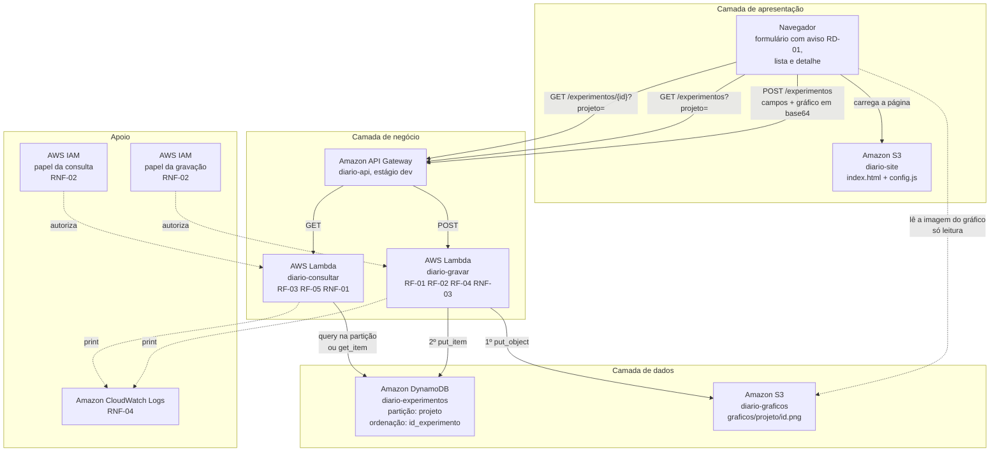

# Documento de Arquitetura

Projeto: Diário de Experimentos (`diario-de-experimentos`)  
Cenário oficial escolhido: Ideia própria da equipe (Diário de Experimentos)  
Data: 15/10/2026  
Versão: 1.0

## 1. Requisitos não funcionais

Os quatro partem do FURPS da Sprint 1. A preocupação de Performance virou o RNF-01, a de Reliability virou o RNF-03 e a de Supportability virou o RNF-04, na categoria de nuvem Observabilidade. O RNF-02, de Segurança, vem das categorias de nuvem e do RD-02: um diário que não pode ser alterado precisa de funções que não consigam alterá-lo.

As linhas de Functionality e de Usability do FURPS não viraram requisito não funcional porque já estão cobertas em outro lugar. A de Functionality — a métrica voltar exatamente como foi registrada — é o critério US-01, cenário 1 ("0,412 sem arredondamento"), e decide o tipo do campo `valor` (seções 6.1 e 9). A de Usability — aceitar 0,412 e 0.412 como o mesmo número — é regra da função de gravação (seção 5.2).

### RNF-01

```text
requisito
  [Performance] A lista dos experimentos de um projeto deve
  responder em menos de 1.000 ms no percentil 95, com 100
  experimentos no projeto consultado e 30 requisições
  seguidas.

serviço AWS
  Amazon DynamoDB

pilar do Well-Architected
  4, Eficiência de Performance

razão
  A chave de partição por projeto mantém a consulta dentro
  de uma única partição, e a chave de ordenação, que começa
  pela data e hora, faz o próprio banco devolver os
  experimentos do mais recente para o mais antigo. Não há
  scan nem ordenação depois: o tempo depende só do tamanho do
  projeto consultado, e não da tabela inteira. É a segunda
  metade da preocupação de Performance da Sprint 1 — o tempo
  não pode crescer conforme outros projetos acumulam
  experimentos.
```

### RNF-02

```text
requisito
  [Segurança] As duas funções devem ter zero ações de exclusão
  ou de atualização (Delete*, Update*), a função de consulta
  deve ter zero permissões de escrita, e as duas só podem agir
  sobre a tabela, o bucket de gráficos e os registros deste
  projeto — o que se confere na política anexada ao papel de
  cada uma.

serviço AWS
  AWS IAM, com um papel para cada função

pilar do Well-Architected
  2, Segurança

razão
  O RD-02 diz que experimento registrado não se altera nem se
  apaga. Sem ação de exclusão ou de atualização no papel, nem
  um defeito no código consegue apagar um experimento ou
  editar seus campos. A nuvem não cobre tudo: o PutItem, que a
  gravação precisa, substituiria um item de mesma chave, e
  quem impede isso é a condição do put_item, no código (seção
  9). A função de gravação recebe arquivo vindo da internet; a
  de consulta só precisa ler, e com papel próprio uma falha
  nela nunca vira dado gravado.
```

### RNF-03

```text
requisito
  [Reliability] Nenhum experimento pode ficar registrado sem o
  seu gráfico: zero itens na tabela cujo gráfico não exista no
  bucket, inclusive quando o bucket de gráficos está fora do
  ar no momento da gravação.

serviço AWS
  AWS Lambda, na função de gravação, que escreve primeiro no
  Amazon S3 e só depois no Amazon DynamoDB

pilar do Well-Architected
  3, Confiabilidade

razão
  É a preocupação de Reliability da Sprint 1 e a condição do
  RF-02: confirmar o registro somente depois que o arquivo
  estiver guardado. A função grava o gráfico primeiro e só
  então o experimento. Se o gráfico não puder ser guardado, o
  experimento não chega a existir, e a pessoa é avisada para
  tentar de novo. O contrário — gráfico guardado e tabela
  fora do ar — deixa um gráfico sem experimento, que não
  aparece em lugar nenhum (seção 9).
```

### RNF-04

```text
requisito
  [Observabilidade] Toda gravação recusada ou com falha deve
  deixar no CloudWatch Logs uma linha com data e hora,
  projeto e motivo, visível em no máximo 10 segundos depois
  da resposta.

serviço AWS
  Amazon CloudWatch Logs

pilar do Well-Architected
  1, Excelência Operacional

razão
  É a preocupação de Supportability da Sprint 1: quem mantém
  o sistema precisa descobrir por que um registro falhou sem
  ter visto o erro acontecer. Sem a linha, a única pista de
  uma recusa é a memória de quem a viu na tela. A linha leva
  o projeto e o motivo, e nunca o conteúdo enviado, para que
  o log não guarde dado que o RD-01 manda manter fora. Ela
  serve para operar e investigar o sistema no dia a dia, que
  é a pergunta do pilar 1.
```

### 1.1 Resumo

| ID     | Categoria       | Métrica                                                     | Serviço AWS                             | Pilar                        |
|--------|-----------------|-------------------------------------------------------------|-----------------------------------------|------------------------------|
| RNF-01 | Performance     | p95 < 1.000 ms, com 100 experimentos no projeto             | Amazon DynamoDB                         | 4, Eficiência de Performance |
| RNF-02 | Segurança       | 0 permissões de exclusão ou alteração; 0 de escrita na consulta | AWS IAM                             | 2, Segurança                 |
| RNF-03 | Reliability     | 0 experimentos registrados sem gráfico                      | AWS Lambda, Amazon S3 e Amazon DynamoDB | 3, Confiabilidade            |
| RNF-04 | Observabilidade | registro de cada recusa visível em até 10 s                 | Amazon CloudWatch Logs                  | 1, Excelência Operacional    |

### 1.2 O pilar não contemplado

O pilar 5, Otimização de Custos, não virou requisito porque em ambiente emulado não existe fatura: qualquer número de custo seria inventado. O desenho, mesmo assim, responde à pergunta do pilar. Um projeto de experimentos é usado em rajadas — dezenas de rodadas na semana de entrega de um trabalho, e depois semanas parado, como na US-03. Lambda parada não custa nada, a tabela em modo sob demanda cobra só o que é lido e gravado, e o S3 cobra pelo espaço dos gráficos. Um servidor ligado o mês inteiro pagaria justamente as semanas paradas.

O pilar 6, Sustentabilidade, também ficou sem número, porque sem medir consumo de máquina e de energia qualquer número seria inventado. A pergunta dele — entregar o mesmo gastando menos — foi respondida no recorte da Sprint 1: o sistema não guarda o conjunto de dados do treino, só o resultado agregado e um gráfico de até 2 MB. Guardar o que ninguém vai reabrir é o desperdício que esse pilar aponta.

## 2. A arquitetura em três camadas

| Camada       | O que fica nela, neste projeto                                                                                                                                                       | Serviço AWS                                                                          |
|--------------|--------------------------------------------------------------------------------------------------------------------------------------------------------------------------------------|--------------------------------------------------------------------------------------|
| Apresentação | A página `index.html`: o formulário de novo experimento, com o aviso de que só entram resultados agregados (RD-01); a lista do projeto; e o detalhe de um experimento, com o gráfico | Amazon S3, bucket `diario-site`, em modo site estático                               |
| Negócio      | As funções `gravar` e `consultar`, e a porta de entrada que as chama                                                                                                                 | AWS Lambda e Amazon API Gateway                                                      |
| Dados        | A tabela de experimentos e os arquivos dos gráficos                                                                                                                                  | Amazon DynamoDB, tabela `diario-experimentos`, e Amazon S3, bucket `diario-graficos` |

O S3 aparece em duas camadas, em dois buckets separados: um guarda a página, que é apresentação, e o outro guarda os gráficos, que são dado.

### 2.1 Como a separação é garantida

A página é um arquivo estático e não tem credencial nenhuma: o `config.js` carrega apenas o endereço público da API. Quem ler o código-fonte da página no navegador encontra esse endereço e mais nada.

Toda escrita passa pelo API Gateway e pela função `gravar`, e é ela que decide o que entra. A recusa de registro incompleto ou com métrica inválida (RF-04) fica na função, e não na página: a página pode avisar antes de enviar, por gentileza com quem usa, mas basta mandar a requisição sem passar por ela para pular essa checagem. A permissão de escrever na tabela e no bucket fica nos papéis do IAM, do lado da AWS, e nunca chega ao navegador.

A única leitura que não passa pela API é a imagem do gráfico, que o navegador busca pelo endereço que a própria API devolveu. É uma exceção declarada: é só leitura, sem credencial, de um arquivo que o RD-01 garante não ter dado pessoal, e nada é gravado por esse caminho. A razão está na seção 9.

## 3. Estilo arquitetural

| Item                             | Resposta                                                                                                                                                                                                                                                                                                                                       |
|----------------------------------|------------------------------------------------------------------------------------------------------------------------------------------------------------------------------------------------------------------------------------------------------------------------------------------------------------------------------------------------|
| Estilo adotado                   | Distributed: duas funções independentes, uma que grava e uma que consulta, atrás de um ponto único de entrada                                                                                                                                                                                                                                |
| Por que ele serve a este projeto | Gravar e consultar têm ritmos diferentes: a gravação acontece uma vez por rodada de treino; a lista é aberta a cada rodada nova, para comparar, e de novo quando a dupla escolhe o modelo do relatório. Separadas, cada função tem só as permissões de que precisa (RNF-02), e um defeito na gravação não tira do ar a consulta do que já está guardado. |
| Estilo descartado                | Implicit Invocation: a página enviaria o gráfico direto ao S3, e a chegada do arquivo dispararia sozinha a função que registra o experimento                                                                                                                                                                                                |
| Por que foi descartado           | O registro tem de responder na hora a quem está na tela: o RF-02 só confirma depois que o gráfico está guardado, o RF-04 precisa dizer qual campo está errado, e a US-01 devolve o identificador. Pelo evento, a página saberia apenas que o arquivo subiu; uma métrica "baixo" seria recusada longe de quem digitou, e o gráfico já estaria guardado, contra o US-01, cenário 2 (0 gráficos novos). |

## 4. Padrões arquiteturais identificados

| Padrão                 | Onde ele aparece no meu desenho                                                                                                                                                                       | O que ele resolve aqui                                                                                             |
|------------------------|-------------------------------------------------------------------------------------------------------------------------------------------------------------------------------------------------------|--------------------------------------------------------------------------------------------------------------------|
| API Gateway            | O Amazon API Gateway, porta única das três rotas: `POST /experimentos`, `GET /experimentos?projeto=` e `GET /experimentos/{id}?projeto=`                                                            | A página conhece um endereço só, e as funções não precisam cuidar de roteamento                                    |
| CQRS, na forma simples | O caminho que grava (`POST` → `gravar`) e o que lê (`GET` → `consultar`) são separados, cada um com função e papel próprios. Os dois usam a mesma tabela: a escrita recebe o gráfico e valida; a leitura devolve a lista já ordenada | A consulta não divide permissão nem código com a gravação: ela não consegue escrever (RNF-02), e mudar a validação não mexe na lista |
| MVC                    | A página é a visão; as duas funções são o controle; o experimento, na tabela e no bucket, é o modelo                                                                                                   | A tela pode ser refeita inteira sem tocar na regra que recusa métrica não numérica, e a regra pode mudar sem mexer na tela |

### 4.1 O padrão que faria falta

**Event Sourcing.** O RD-02 manda corrigir um experimento registrando outro, e o desenho faz isso — mas nada liga a rodada nova à que ela corrige. Na lista, as duas aparecem lado a lado, e quem retoma o projeto semanas depois (US-03) não sabe qual das duas vale. Com Event Sourcing, cada registro seria um fato — "experimento registrado", "experimento corrigido, substituindo tal identificador" —, nenhum seria apagado, e a lista mostraria o estado atual sem perder o histórico.

Ele entraria na função `gravar`, com um campo opcional que aponta o identificador corrigido, e na `consultar`, que esconderia da lista o que foi substituído. Fica fora porque correção é rara em um diário de poucas dezenas de rodadas por projeto, e a lista ordenada já mostra a rodada nova no topo.

## 5. Diagrama de arquitetura de ponta a ponta



As setas cheias são o caminho do dado. As pontilhadas não carregam dado do usuário: são permissão, registro e a leitura da imagem do gráfico, a única que vai do navegador direto à camada de dados (seção 2.1). Nenhuma seta liga o navegador à tabela.

A função `gravar` tem duas setas de saída numeradas, e a ordem é o RNF-03: primeiro o gráfico, depois o experimento.

### 5.1 Legenda das caixas

| Caixa                  | Serviço AWS            | O que ela faz                                                                                                                         | Requisito que a justifica                          |
|------------------------|------------------------|---------------------------------------------------------------------------------------------------------------------------------------|----------------------------------------------------|
| Navegador              | —                      | Exibe o formulário com o aviso do RD-01, a lista e o detalhe; envia o gráfico em base64; busca a imagem do gráfico pelo endereço devolvido | US-01, US-02, US-03, RD-01                         |
| Site estático          | Amazon S3              | Serve `index.html` e `config.js` a partir do bucket `diario-site`                                                                     | US-01, US-02, US-03                                |
| Entrada da API         | Amazon API Gateway     | Recebe as três rotas e invoca a função certa: `POST` para a `gravar`, `GET` para a `consultar`                                        | US-01, US-02, US-03: é por ela que passam as rotas |
| Função gravar          | AWS Lambda             | Valida, grava o gráfico e depois o experimento, e registra cada recusa                                                                | RF-01, RF-02, RF-04, RNF-03                        |
| Função consultar       | AWS Lambda             | Lista o projeto com um `query`, do mais recente ao mais antigo, ou abre um experimento com um `get_item`                               | RF-03, RF-05, RNF-01                               |
| Tabela de experimentos | Amazon DynamoDB        | Guarda o experimento, com `projeto` na partição e `id_experimento` na ordenação                                                       | RF-01, RF-03, RF-05, RNF-01                        |
| Bucket de gráficos     | Amazon S3              | Guarda o PNG em `graficos/<projeto>/<id>.png`, com leitura pública dos arquivos                                                        | RF-02, RNF-03                                      |
| Papel da gravação      | AWS IAM                | Permite só gravar o gráfico, inserir o experimento e escrever o próprio registro                                                      | RNF-02, RD-02                                      |
| Papel da consulta      | AWS IAM                | Permite só ler a tabela e escrever o próprio registro                                                                                 | RNF-02                                             |
| Registros              | Amazon CloudWatch Logs | Guarda o que cada execução imprimiu, inclusive cada recusa, com projeto e motivo                                                     | RNF-04                                             |

### 5.2 O fluxo de uma requisição

Quem treina termina uma rodada, abre a página e preenche o projeto, o modelo, os hiperparâmetros, o nome e o valor da métrica, e escolhe o PNG do gráfico. Junto do formulário, o aviso do RD-01 lembra que o registro leva só resultados agregados. Ao clicar em "Registrar", o navegador converte o arquivo para base64 e envia tudo em um único `POST` para a rota `/experimentos` do API Gateway, que invoca a função `gravar`.

A função confere tudo antes de gravar qualquer coisa. Grava o projeto em minúsculas e sem espaços nas pontas. Recusa com 400, dizendo o campo, se faltar projeto, modelo, métrica, valor ou gráfico. Aceita o valor com vírgula ou com ponto; se não for número — como "baixo" —, recusa com 400 e a mensagem de que o valor da métrica precisa ser numérico. Recusa também o gráfico que não for PNG ou que passar de 2 MB. Cada recusa imprime uma linha com projeto e motivo, que vai para o CloudWatch Logs (RNF-04).

Com tudo válido, a função gera o identificador — a data e hora, mais alguns caracteres aleatórios — e grava primeiro o gráfico no bucket, em `graficos/<projeto>/<id>.png`. Só depois grava o experimento na tabela, e só se aquele identificador ainda não existir: nada é sobrescrito (RD-02). Então devolve 201, com o identificador e o endereço do gráfico.

A página consulta em seguida: um `GET` em `/experimentos?projeto=previsao-inflacao` chega à função `consultar`, que faz um `query` na partição do projeto e recebe os experimentos já do mais recente para o mais antigo. A resposta é 200 com o total e a lista, e o registro novo aparece no topo. Se o projeto não tiver nenhum experimento, a resposta continua sendo 200, com total zero, e a página mostra no lugar da tabela o convite para registrar o primeiro (US-02, cenário 2). Clicar em um identificador faz um `GET` em `/experimentos/{id}?projeto=...`, que a mesma função atende com um `get_item` pelo projeto e pelo identificador; se o identificador não existir naquele projeto, a resposta é 404, com a mensagem de que o experimento não foi encontrado (US-03, cenário 2).

### 5.3 O que acontece se uma caixa cair

| Caixa                  | Efeito da queda                                                               | O que o sistema ainda consegue fazer                                                                                              |
|------------------------|-------------------------------------------------------------------------------|-----------------------------------------------------------------------------------------------------------------------------------|
| Site estático          | Ninguém chega pela tela                                                       | A API continua respondendo: outro cliente, ou o `curl`, continua gravando e consultando                                           |
| Função gravar          | Nenhum experimento novo entra                                                 | A lista e o detalhe continuam funcionando com tudo o que já foi registrado                                                       |
| Função consultar       | A lista e o detalhe somem da tela                                             | A gravação continua aceitando experimentos, e nada se perde; a lista volta inteira quando a função voltar                         |
| Tabela de experimentos | Nada funciona: a consulta falha, e a gravação falha depois de subir o gráfico | Nada. Os gráficos já guardados continuam no bucket, mas os números de cada rodada só existem na tabela                            |
| Bucket de gráficos     | A gravação falha antes de tocar a tabela, e as imagens não carregam           | A lista e o detalhe continuam com todos os números, e nenhum experimento novo fica sem gráfico (RNF-03)                           |
| Registros              | Recusas e falhas deixam de deixar rastro                                      | Para quem usa, tudo funciona; quem mantém o sistema perde a forma de investigar (RNF-04)                                          |

## 6. Modelo de dados

### 6.1 Entidades

| Entidade    | Campo             | Tipo                                                                                            | Obrigatório                                                            |
|-------------|-------------------|-------------------------------------------------------------------------------------------------|------------------------------------------------------------------------|
| Experimento | `projeto`         | texto, chave de partição, em minúsculas                                                         | sim                                                                    |
| Experimento | `id_experimento`  | texto, chave de ordenação: data e hora mais alguns caracteres aleatórios, com microssegundos, como `20261021-140312-123456-7f3a9c` | sim, gerado                                                    |
| Experimento | `criado_em`       | texto, data e hora em ISO 8601                                                                  | sim, gerado                                                            |
| Experimento | `modelo`          | texto                                                                                           | sim                                                                    |
| Experimento | `hiperparametros` | texto, guardado exatamente como digitado                                                        | não: o modelo de referência não tem hiperparâmetro (Sprint 1, seção 2) |
| Experimento | `metrica`         | texto, o nome da métrica, como RMSE                                                             | sim                                                                    |
| Experimento | `valor`           | número exato (`Decimal`), inclusive negativo, como um R² abaixo de zero                         | sim                                                                    |
| Experimento | `grafico`         | texto, caminho do PNG no bucket de gráficos                                                     | sim, gerado na gravação                                                |

### 6.2 A chave de partição

| Item                                    | Resposta                                                                                                                                                                                                      |
|-----------------------------------------|---------------------------------------------------------------------------------------------------------------------------------------------------------------------------------------------------------------|
| Campo escolhido como chave de partição  | `projeto`                                                                                                                                                                                                     |
| Campo escolhido como chave de ordenação | `id_experimento`, que começa pela data e hora                                                                                                                                                                 |
| Qual consulta esta escolha torna barata | "Todos os experimentos do `previsao-inflacao`, do mais recente ao mais antigo": um `query` que vai direto a uma partição e já volta na ordem. E abrir um experimento pelo projeto e pelo identificador (RF-05) |
| Qual consulta esta escolha torna cara   | "Todos os experimentos com RMSE abaixo de 0,4, de qualquer projeto": exige um `scan` na tabela inteira. Nenhuma tela faz essa pergunta; o ranking entre experimentos ficou fora do escopo na Sprint 1           |
| Alternativa descartada                  | `id_experimento` como chave de partição: é único, mas nenhuma tela começa por ele                                                                                                                            |

A pergunta que a tela responde é "quais experimentos existem no projeto X, do mais recente ao mais antigo?", e o projeto é o que a pessoa digita na busca. Todo acesso começa por ele: a lista pede um projeto, e até a abertura de um experimento específico pede o projeto junto com o identificador (RF-05). Nenhuma consulta pede "todos os experimentos de todos os projetos".

A chave de ordenação faz dois trabalhos. Ela distingue os experimentos do mesmo projeto, porque nenhum identificador se repete, e ela ordena, porque começa pela data e hora: ordenar pelo identificador é ordenar pela data. É isso que deixa o próprio banco devolver a lista na ordem que o RF-03 pede.

### 6.3 O que fica no S3 e o que fica no DynamoDB

| Dado                                                          | Onde fica                                                             | Por quê                                                                                                                                                  |
|---------------------------------------------------------------|-----------------------------------------------------------------------|----------------------------------------------------------------------------------------------------------------------------------------------------------|
| Projeto, identificador, data, modelo, nome e valor da métrica | Amazon DynamoDB, tabela `diario-experimentos`                         | São pequenos e são exatamente o que a lista mostra                                                                                                       |
| Os hiperparâmetros                                            | Amazon DynamoDB, na mesma tabela, como texto                          | São poucas dezenas de caracteres e precisam voltar idênticos aos digitados (US-03, cenário 1)                                                            |
| O gráfico do resultado, em PNG                                | Amazon S3, bucket `diario-graficos`, em `graficos/<projeto>/<id>.png` | Um gráfico chega a 2 MB, e um item do DynamoDB aceita no máximo 400 KB. A lista nem mostra a imagem; carregá-la junto deixaria a consulta lenta. A tabela guarda só o caminho |

## 7. Backlog priorizado

| ID     | Item                                                                                                                | Tipo | Prioridade |
|--------|---------------------------------------------------------------------------------------------------------------------|------|------------|
| RF-01  | Registrar o experimento com projeto, modelo, hiperparâmetros, métrica e valor, gerando identificador e data e hora | RF   | Alta       |
| RF-02  | Armazenar o gráfico no Amazon S3, confirmando o registro só depois de guardado                                      | RF   | Alta       |
| RF-03  | Listar os experimentos do projeto, do mais recente ao mais antigo                                                   | RF   | Alta       |
| RF-04  | Recusar registro incompleto ou com métrica não numérica, dizendo o campo                                            | RF   | Alta       |
| US-01  | Registrar cada rodada de treino com modelo, hiperparâmetros, métrica e gráfico                                      | US   | Alta       |
| US-02  | A dupla vê todos os experimentos do projeto, do mais recente ao mais antigo                                         | US   | Alta       |
| RF-05  | Exibir um experimento específico, completo, pelo projeto e pelo identificador                                       | RF   | Média      |
| US-03  | Abrir um experimento com todos os hiperparâmetros e o gráfico, semanas depois do treino                             | US   | Média      |
| RNF-01 | Lista do projeto em menos de 1.000 ms no p95, com 100 experimentos                                                  | RNF  | Média      |
| RNF-03 | Zero experimentos registrados sem gráfico, inclusive com o bucket fora do ar                                        | RNF  | Média      |
| RNF-02 | Zero permissões de exclusão ou alteração; zero de escrita na consulta                                               | RNF  | Baixa      |
| RNF-04 | Toda recusa registrada no CloudWatch Logs em até 10 segundos                                                        | RNF  | Baixa      |

### 7.1 Distribuição

| Prioridade | Quantidade |
|------------|------------|
| Alta       | 6          |
| Média      | 4          |
| Baixa      | 2          |

Metade ficou em alta. A prioridade dos requisitos funcionais é a mesma da Sprint 1: os quatro essenciais são alta, e o RF-05, importante, é média. A US-03 e o RF-05 falam da mesma coisa, abrir um experimento completo, e por isso estão na mesma prioridade; a US-01 contém o RF-01, o RF-02 e o RF-04, e a US-02 contém o RF-03, todos em alta.

O RNF-01 ficou em média porque o sistema existe sem ele, só mais lento — mas a lista é aberta a cada rodada nova, e por isso ele não ficou em baixa. O RNF-03 também ficou em média: no uso normal, gravar o gráfico antes do experimento já é condição do RF-02, que está em alta; o RNF-03 estende essa garantia ao caso em que algo falha.

O RNF-02 e o RNF-04 ficaram em baixa porque servem a quem opera e mantém o sistema, e não a quem registra experimentos: no primeiro dia, ninguém sente falta deles. Os dois entram no recorte mesmo assim, pela razão da seção 8.

## 8. Recorte de implementação

| Item                                       | Resposta                                                                                                                                                                                                                                                                                                                                                       |
|--------------------------------------------|----------------------------------------------------------------------------------------------------------------------------------------------------------------------------------------------------------------------------------------------------------------------------------------------------------------------------------------------------------------|
| O que será implementado nas Sprints 3 e 4  | Os doze itens do backlog. Na Sprint 3, o caminho da gravação: RF-01, RF-02, RF-04, RNF-02, RNF-03 e o registro do RNF-04. Na Sprint 4, o que depende de haver o que consultar e de existir a página: RF-03, RF-05, US-01, US-02, US-03 e RNF-01.                                                                                                                 |
| O que fica especificado e não implementado | Nenhum item do backlog. Fica de fora, declarado: a paginação da lista além dos 100 experimentos mais recentes (seção 9) e a ligação entre uma correção e o experimento corrigido (o Event Sourcing da seção 4.1). Continuam fora do escopo, como declarado na Sprint 1: conta de usuário, login e permissão por projeto; treino do modelo dentro do sistema; edição ou exclusão de experimento (RD-02); gráfico comparativo e ranking automático. |
| Por que este corte                         | Toda a prioridade alta cabe nas duas sprints, e os itens de média e baixa custam pouco porque não pedem peça nova. A US-03 e o RF-05 não exigem uma terceira função: a `consultar` abre o experimento específico com um `get_item`, com o mesmo papel da lista. O RNF-02 custa um segundo papel no IAM. O RNF-03 é a ordem de duas gravações na função `gravar`, e o RNF-04, uma linha de registro por recusa. |

A ordem dentro de cada sprint segue a dependência real. O RF-02 não vem antes do RF-01 porque o caminho do gráfico inclui o identificador, e o identificador nasce no RF-01. E só há o que listar depois que existe gravação.

## 9. Decisões e alternativas descartadas

| Decisão                                                                     | Alternativa considerada                                                                | Por que não foi escolhida                                                                                                                                                                                                                                                  |
|-----------------------------------------------------------------------------|----------------------------------------------------------------------------------------|----------------------------------------------------------------------------------------------------------------------------------------------------------------------------------------------------------------------------------------------------------------------------|
| Estilo arquitetural: Distributed                                            | Implicit Invocation, com a chegada do gráfico ao S3 disparando o registro              | O registro precisa responder na hora com o identificador ou com o campo errado (RF-02, RF-04, US-01). Pelo evento, a resposta viria depois, longe de quem digitou, e o gráfico já estaria guardado mesmo quando o experimento fosse recusado.                               |
| Chave de partição: `projeto`                                                | `id_experimento` como chave de partição                                                | O identificador é único, mas nenhuma tela começa por ele. Cada experimento ficaria sozinho em uma partição, e listar um projeto viraria um scan na tabela inteira, que o RNF-01 não permite.                                                                               |
| Recorte de implementação: os doze itens                                    | Só a prioridade alta, deixando o RF-05 e a US-03 especificados e não implementados     | Seria legítimo e um pouco mais barato, mas abrir o experimento completo é o que permite reproduzir a configuração vencedora — a razão de ser da US-03 —, e custa só uma rota na função que já existe.                                                                     |
| Chave de ordenação: `id_experimento` começando pela data e hora             | Identificador aleatório na ordenação, com a função ordenando por `criado_em` depois    | Com identificador aleatório, o banco devolveria os itens fora de ordem, e a função teria de ler o projeto inteiro e ordenar a cada consulta. Com a data na frente, o próprio `query` devolve na ordem do RF-03. Os caracteres aleatórios do final desempatam duas gravações no mesmo instante. |
| Valor da métrica como número exato (`Decimal`), aceitando vírgula ou ponto | Número de ponto flutuante, ou texto                                                    | O ponto flutuante pode devolver 0,412 como 0,41199999, o que quebra o US-01, cenário 1, e o DynamoDB nem o aceita. Texto não se ordena nem se compara como número. O `Decimal` guarda o número exatamente como foi digitado.                                               |
| O gráfico, em PNG de até 2 MB, viaja em base64 dentro do `POST`            | Envio direto ao S3 com URL pré-assinada                                                | Pela URL, o arquivo chegaria ao bucket antes da validação, e o US-01, cenário 2 (0 gráficos novos), só passaria apagando o arquivo — permissão que o RNF-02 proíbe. Um PNG de gráfico tem dezenas ou centenas de KB, e o limite de 2 MB dá folga. Para arquivos de vários MB, a URL pré-assinada passaria a ser a escolha certa. |
| Gráfico lido por endereço público, só leitura                               | URL pré-assinada de leitura, gerada a cada consulta                                    | Sem login, que ficou fora do escopo na Sprint 1, quem tem a página já lê todos os experimentos pela API; a URL pré-assinada só acrescentaria prazo de validade. O RD-01 garante que o gráfico não tem dado pessoal. Se o login entrar no escopo, esta decisão se inverte. |
| Bucket do site separado do bucket de gráficos                               | Um bucket só, com a página e os gráficos                                               | São camadas diferentes, com regras de acesso diferentes. Separados, cada bucket tem a sua política, e republicar a página não toca nos dados.                                                                                                                             |
| Um papel do IAM para cada função                                            | Um papel só para as duas funções                                                       | Com papel único, a função de consulta herdaria a permissão de gravar, e o RNF-02 nasceria descumprido.                                                                                                                                                                    |
| Projeto gravado em minúsculas e sem espaços nas pontas                      | Projeto exatamente como digitado                                                       | "Previsao-Inflacao" e "previsao-inflacao" virariam partições diferentes, e a dupla da US-02 não veria as rodadas do colega. A normalização não pega erro de digitação, como "previsao-inflacão", que continua possível e fica declarado aqui.                             |
| Gráfico sem experimento aceito quando a tabela falha depois do envio        | Apagar o gráfico se a gravação na tabela falhar                                        | Apagar exigiria a permissão de exclusão que o RNF-02 proíbe. O gráfico sem experimento não aparece em lista nenhuma; o que o FURPS de Reliability proíbe é o contrário, experimento sem gráfico.                                                                          |
| Lista limitada aos 100 experimentos mais recentes                           | Paginação, devolvendo o restante em páginas seguintes                                  | Um projeto acumula dezenas de rodadas, e o FURPS de Performance fala em até 100. Paginar acrescentaria um parâmetro de continuação na API e na página. Acima de 100 experimentos por projeto, a paginação passa a ser necessária.                                        |
| Nomes dos campos: os do cenário — `projeto`, `id_experimento`, `criado_em`, `modelo`, `hiperparametros`, `metrica`, `valor` e `grafico` | Os nomes genéricos do código do roteiro da Sprint 3: `id_particao`, `descricao` e `valor` | Quem abre a tabela ou o log entende sem tradução, e os nomes são os mesmos do RF-01 e do modelo de dados (seção 6.1). Com os genéricos, seria preciso lembrar que `id_particao` quer dizer projeto. |
| O que a função valida antes de gravar: os cinco campos obrigatórios, o valor como número finito, com vírgula ou ponto, e o gráfico como PNG em base64 de até 2 MB | Recusar valor zero ou negativo, como o código do roteiro da Sprint 3 faz | Métrica não é preço: um R² pode ser negativo, e um erro pode ser zero. O RF-04 pede só que o valor seja numérico. |
| Sobrescrita barrada por duas camadas: o papel não tem `Delete*` nem `Update*`, e o `put_item` é condicional (`attribute_not_exists`) | Confiar só no IAM para garantir o RD-02 | O IAM não distingue inserir de substituir: quem tem `dynamodb:PutItem` pode trocar um item de mesma chave, e `s3:PutObject` pode trocar um arquivo. A condição barra a substituição na tabela, e o identificador com parte aleatória evita colisão no bucket. É um limite declarado: um defeito que removesse a condição não seria barrado pelo IAM. |
| Projeto com barra, ou feito só de pontos, é recusado com 400 | Aceitar qualquer texto no projeto | O projeto vira pasta em `graficos/<projeto>/`: com `../fora`, o navegador normalizaria o caminho e o endereço do gráfico devolvido não abriria. Acento continua aceito. |
| O que entra no log: data e hora, projeto e motivo de cada recusa ou falha, e o identificador de cada gravação | O corpo inteiro da requisição | O corpo traz o gráfico em base64 e textos livres: o log ficaria pesado e guardaria conteúdo que o RD-01 manda manter fora. Para investigar, basta saber quando, em que projeto e por quê. |
| Rotas: `POST /experimentos`, `GET /experimentos?projeto=` e `GET /experimentos/{id}?projeto=` | Uma rota só, `GET /experimentos?projeto=&id=`, para a lista e para o detalhe | O caminho com o identificador separa a coleção de um item, que é onde quem já usou uma API espera achar cada coisa. O projeto continua obrigatório no detalhe porque a chave da tabela é projeto mais identificador (seção 6.2). |
| O que a API devolve: 201 ao gravar; 400 dizendo o campo; 503 quando o gráfico ou a tabela não respondem; 200 com total 0 para projeto vazio; 404 para identificador que não existe no projeto | 404 também para projeto sem experimentos | Projeto vazio é uma resposta legítima: a pergunta foi respondida, e a resposta é "nenhum" (US-02, cenário 2). Identificador que não existe é erro de quem pediu (US-03, cenário 2). |
| A página, quando não há nada: no lugar da tabela, a frase de que o projeto ainda não tem experimentos e o botão "Registrar o primeiro" | Mostrar a tabela vazia | Tabela vazia parece falha de carregamento; o US-02, cenário 2, pede a mensagem e o convite. |
| As respostas da API trazem a `trilha`: o que a função fez em cada serviço, com o tempo de cada passo | Devolver só o dado pedido | A trilha alimenta o painel "Por trás da tela" da página, que mostra a arquitetura funcionando a cada clique. Custa alguns bytes por resposta e não expõe credencial: só nomes de serviço, caminhos e tempos. Num sistema aberto a usuários de fora, ela sairia da resposta e ficaria só no log. |
| A rota `OPTIONS /experimentos`, de integração `mock`, responde à verificação prévia do navegador (CORS) | Mandar o `POST` como `text/plain`, que não dispara a verificação prévia | Seria um atalho para contornar o navegador: a API diria que recebe JSON sem receber. Com a rota `OPTIONS`, a página manda `application/json` de verdade, e o próprio `openapi.yaml` declara os cabeçalhos. |
| A página chama a API pelo endereço `http://localhost:4566/_aws/execute-api/<id>/dev` | O endereço `http://<id>.execute-api.localhost.localstack.cloud:4566/dev` | O segundo depende de um DNS público que nem toda rede resolve, e a demonstração é ao vivo, numa rede que não controlamos. Na AWS real, os dois viram o endereço `execute-api` da região. |
